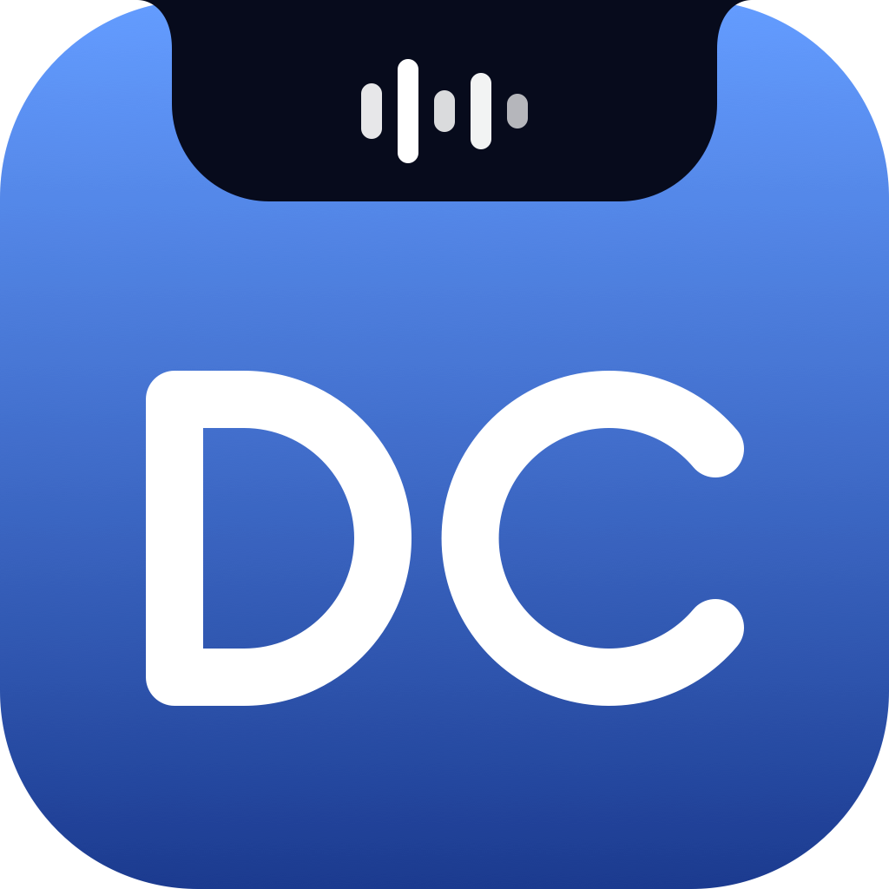
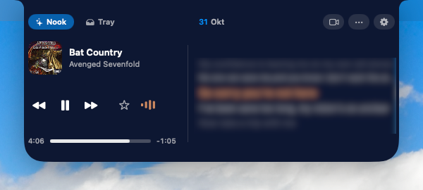
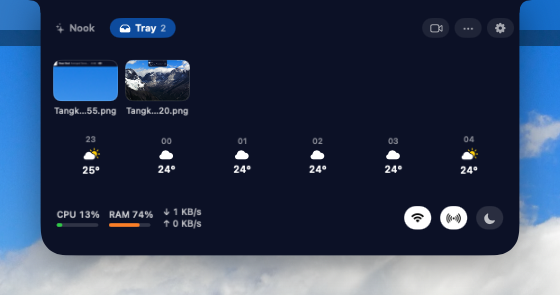
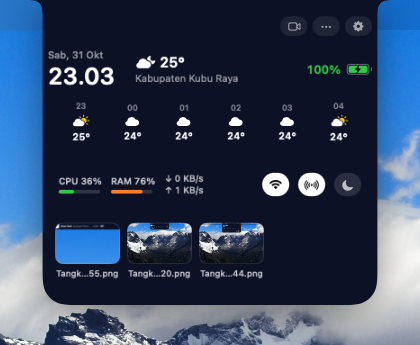
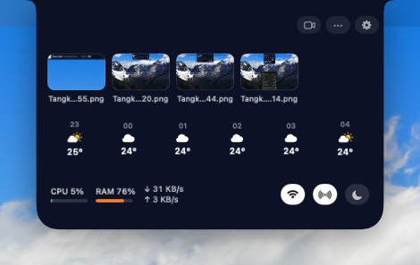

# DC Island

**Bagian atas layar Mac Anda, jadi pusat kendali.**

Musik, timer, kalender, shelf file, dan status dev dalam satu pil di atas layar.
Bekerja di Mac dengan notch maupun tanpa notch.

[**⬇ Unduh versi terbaru**](../../releases/latest) · [English](#english)

---

## Fitur

| | |
|---|---|
| 🎵 **Musik & media** | Now Playing dari Spotify, Apple Music, dan YouTube, lirik tersinkron, kontrol output audio dan volume, tombol suka (Apple Music) |
| 🗂 **Shelf (Tray)** | Taruh file sementara, pratinjau, aksi cepat, seret keluar kapan saja, hapus otomatis |
| 📋 **Clipboard** | Riwayat clipboard, tempel ke-1..9 dengan `⌘1`–`⌘9`, konversi cepat dari teks yang disalin |
| ⏱ **Produktivitas** | Timer, Pomodoro, kalender dan meeting, Reminders |
| 💻 **Sistem** | Cuaca per jam, CPU/RAM/jaringan, Wi-Fi, Bluetooth, Do Not Disturb, baterai Mac dan perangkat, indikator privasi |
| 🛠 **Untuk developer** | Status server, port yang terbuka, build GitHub Actions |
| 🎨 **Tampilan** | Tiga gaya (Klasik, Nook, Ringkas), warna aksen, menyatu dengan tepi atas seperti notch, profil |

<table>
  <tr>
    <td align="center"> Tray: shelf, cuaca, info sistem</td>
    <td align="center"> Gaya Klasik</td>
    <td align="center"> Gaya Ringkas</td>
  </tr>
</table>

## Instalasi

1. Unduh file `DC-Island-<versi>.dmg` dari halaman [Releases](../../releases/latest).
2. Buka DMG, lalu seret **DC Island** ke folder **Applications**.
3. Buka DC Island. Ikonnya muncul di pojok kanan atas layar.

**Persyaratan:** macOS 14 (Sonoma) atau lebih baru. Mac Intel maupun Apple Silicon.

Aplikasi ditandatangani dengan Developer ID dan dinotarisasi Apple, jadi dapat dibuka tanpa peringatan Gatekeeper.

## Izin

Izin hanya diminta saat fitur terkait dipakai, dan semuanya opsional:

| Izin | Dipakai untuk |
|---|---|
| Kalender, Reminders | Agenda, meeting, pengingat |
| Kamera | Cermin kamera |
| Lokasi | Cuaca |
| Bluetooth | Baterai dan status perangkat |
| Full Disk Access | Notifikasi aplikasi |
| Accessibility | Kecerahan dan tempel otomatis |

## Privasi

Tidak ada akun dan tidak ada pelacakan. Riwayat clipboard hanya disimpan di memori.
Layanan eksternal hanya dipakai untuk fitur yang Anda aktifkan:

- cuaca: [Open-Meteo](https://open-meteo.com)
- lirik: [LRCLIB](https://lrclib.net)
- kurs mata uang: [Frankfurter](https://frankfurter.dev)
- status build: GitHub, bila diaktifkan

## Tanya jawab

Apakah perlu Mac dengan notch?

Tidak. Di Mac tanpa notch, DC Island tampil sebagai kapsul di tengah atas layar. Di Mac dengan notch, ia bisa menyatu dengan tepi atas.

Lirik tidak muncul. Kenapa?

Lirik diambil dari LRCLIB. Layanan itu kadang gagal sementara. DC Island mencoba lagi beberapa menit selama lagu masih diputar, dan tidak semua lagu punya lirik tersinkron.

## Masukan dan bug

Temukan bug atau punya ide? Buka [Issues](../../issues) dan sertakan versi macOS, versi DC Island, serta langkah untuk mengulangnya.

---

## English

**DC Island turns the top of your Mac's screen into a control center**: music with synced lyrics, timers, calendar, a file shelf, clipboard history, and dev status, in a single pill. Works on Macs with and without a notch.

- **Download:** get the latest `.dmg` from [Releases](../../releases/latest), open it, and drag **DC Island** to **Applications**.
- **Requirements:** macOS 14 or later, Intel or Apple Silicon.
- **Security:** signed with a Developer ID and notarized by Apple.
- **Privacy:** no accounts, no tracking. External services are used only for weather (Open-Meteo), lyrics (LRCLIB), exchange rates (Frankfurter), and GitHub build status if enabled.
- **Feedback:** open an [issue](../../issues).

---

© 2026 <a href="https://andridesmana.dev">Andri Desmana</a>

